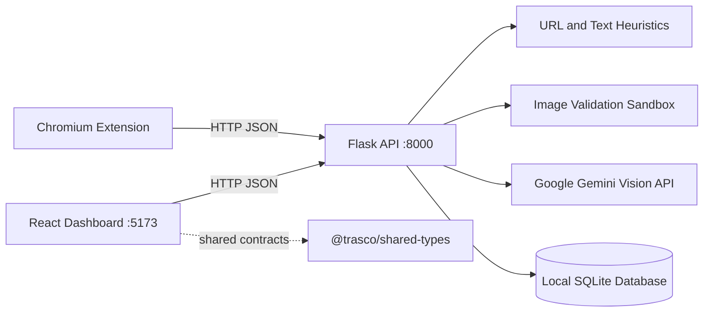

# TRASCO — Trap & Scope

TRASCO adalah platform MVP keamanan siber untuk mendeteksi berbagai modus penipuan daring yang menyasar pengguna di Indonesia. Sistem ini menggabungkan analisis heuristik URL dan teks deterministik dengan integrasi opsional Google Gemini AI, dasbor analitik personal berbasis web, serta ekstensi peramban Chromium.

Proyek ini dikembangkan untuk ajang **MIT UNMUL 2026 Web Development — Cybersecurity Track**. Hasil deteksi bersifat sebagai panduan mitigasi (*advisory*): pengguna disarankan untuk selalu memverifikasi transaksi keuangan dan pemberitahuan akun secara mandiri melalui kanal resmi instansi terkait.

## Memulai Cepat (Quick Start)

Backend dan dasbor berjalan sebagai dua proses lokal terpisah. Direkomendasikan menggunakan Python 3.11 (versi yang digunakan pada CI), Node.js 20, dan npm. Penggunaan Gemini bersifat **opsional** untuk pemindaian URL dan teks, yang tetap mempertahankan analisis heuristik deterministik tanpa kunci API. Gemini diperlukan untuk memindai citra/gambar; jika kunci tidak tersedia, validasi keamanan citra tetap berjalan dan API mengembalikan status `ANALYSIS_UNAVAILABLE` dengan hasil `UNKNOWN` (*fail-closed*).

### Windows PowerShell

Jalankan perintah berikut dari direktori utama (*root*) repositori. Perintah ini membuat *virtual environment*, menginstal dependensi backend, dan menyalin contoh berkas konfigurasi jika belum memiliki berkas `.env` lokal:

```powershell
py -3.11 -m venv apps\backend\.venv
.\apps\backend\.venv\Scripts\python.exe -m pip install -r apps\backend\requirements.txt
Set-Location apps\backend
if (-not (Test-Path .env)) { Copy-Item .env.example .env }
```

Sunting berkas `apps/backend/.env`: atur `SECRET_KEY` dengan nilai baru yang dibuat menggunakan perintah `python -c "import secrets; print(secrets.token_hex(32))"`. Jaga kerahasiaan kunci dan jangan pernah melakukan commit berkas `.env`. Atur `GEMINI_API_KEY` jika ingin mengaktifkan analisis AI multimodal; kunci ini tidak wajib untuk analisis heuristik URL/teks. Basis data lokal bawaan menggunakan `trasco_local.db`, bukan `trasco.db` yang diproteksi.

Inisialisasi skema basis data lokal, kemudian jalankan backend:

```powershell
.\.venv\Scripts\python.exe -m app.core.init_db --url sqlite:///./trasco_local.db --confirm-persistent
.\.venv\Scripts\python.exe -m app.flask_app
```

Buka jendela PowerShell kedua, lalu dari direktori utama (*root*) repositori, pasang dependensi dan jalankan dasbor:

```powershell
Set-Location apps\dashboard
npm ci
npm run dev
```

Buka peramban di [http://127.0.0.1:5173](http://127.0.0.1:5173), pilih menu **Simulator**, dan jalankan pemindaian teks atau URL. Anda juga dapat mengirim pemindaian teks pertama melalui PowerShell:

```powershell
$body = @{ scanType = 'TEXT'; content = 'Saya mendapat tawaran kerja, tetapi diminta membayar biaya deposit terlebih dahulu.' } | ConvertTo-Json
Invoke-RestMethod -Uri http://127.0.0.1:8000/api/v1/detect/analyze -Method Post -ContentType 'application/json' -Headers @{ 'X-Trasco-Source' = 'Dashboard-Client' } -Body $body
```

### macOS/Linux

Jalankan dari direktori utama (*root*) repositori:

```bash
python3.11 -m venv apps/backend/.venv
source apps/backend/.venv/bin/activate
python -m pip install -r apps/backend/requirements.txt
cd apps/backend
if [ ! -f .env ]; then cp .env.example .env; fi
```

Sunting berkas `.env`: tetapkan `SECRET_KEY` baru menggunakan perintah `python -c "import secrets; print(secrets.token_hex(32))"`. Jaga kerahasiaan berkas `.env`. `GEMINI_API_KEY` bersifat opsional untuk pemindaian URL/teks dan hanya diperlukan untuk mengaktifkan analisis multimodal, termasuk pemindaian gambar penipuan.

```bash
python -m app.core.init_db --url sqlite:///./trasco_local.db --confirm-persistent
python -m app.flask_app
```

Di jendela terminal kedua dari direktori utama repositori:

```bash
cd apps/dashboard
npm ci
npm run dev
```

Buka [http://127.0.0.1:5173](http://127.0.0.1:5173), pilih **Simulator**, dan jalankan pemindaian teks atau URL. Untuk pemindaian teks langsung dari terminal:

```bash
curl -sS -X POST http://127.0.0.1:8000/api/v1/detect/analyze \
  -H 'Content-Type: application/json' \
  -H 'X-Trasco-Source: Dashboard-Client' \
  -d '{"scanType":"TEXT","content":"Saya mendapat tawaran kerja, tetapi diminta membayar biaya deposit terlebih dahulu."}'
```

Skrip inisialisasi akan membuat tabel yang belum ada, namun tidak melakukan migrasi pada basis data yang sudah terisi. Gunakan basis data lokal baru yang tidak berisi data penting yang harus dipertahankan. Jangan pernah mengarahkannya ke `apps/backend/trasco.db`.

## Catatan Deploy VPS

Untuk production, build dashboard dengan `VITE_API_BASE_URL=` agar permintaan API menggunakan origin yang sama; Nginx dapat meneruskan `/api/` ke Gunicorn di `127.0.0.1:8000`. Atur `TRASCO_ALLOWED_ORIGINS` di `apps/backend/.env` ke origin dashboard yang persis, misalnya `https://trasco.example.com` atau `http://ALAMAT_IP_VPS`. Jangan membuka port backend `8000` ke internet.

Jalankan Flask melalui Gunicorn (bukan development server), set `DEBUG=False`, dan gunakan `SECRET_KEY` acak minimal 32 karakter. Inisialisasi database baru secara eksplisit dengan `python -m app.core.init_db --url sqlite:///./trasco_local.db --confirm-persistent`. Simpan `.env` dengan izin terbatas dan jangan pernah mengarahkan database ke `trasco.db` yang diproteksi.

### Isolasi Data Dashboard

Log dashboard dianalisis per browser menggunakan cookie penanda acak yang ditandatangani server, `HttpOnly`, dan `Secure` di production. Pastikan dashboard dan API memakai host yang sama; development cross-origin harus menyertakan origin dashboard di `TRASCO_ALLOWED_ORIGINS`. Isolasi ini berbasis profil browser/perangkat, bukan akun: menghapus cookie atau memakai browser lain akan memulai riwayat baru. Jangan gunakan ini sebagai pengganti autentikasi untuk data yang memerlukan sinkronisasi antarperangkat.

Saat memperbarui database production yang sudah ada, buat backup terlebih dahulu, lalu jalankan migrasi aditif satu kali dari direktori `apps/backend` dengan konfigurasi `.env` production:

```bash
python -m app.core.migrate_browser_identity
```

Migrasi hanya menambahkan kolom nullable dan indeks `visitor_id`; tidak menghapus atau mengubah rekaman lama. Rekaman lama yang tidak memiliki pemilik browser tidak ditampilkan kepada pengunjung baru, karena kepemilikannya tidak dapat ditentukan dengan aman. Jalankan migrasi sebelum merestart backend versi baru; readiness akan tetap gagal sampai skema sesuai.

## Fitur dan Status Saat Ini

| Kemampuan | Status |
|---|---|
| Deteksi URL dan teks | Diimplementasikan pada Flask API dengan heuristik deterministik, mencakup promosi judi online, teks tersamarkan (*obfuscated/leetspeak*), pemendek tautan URL, serta pola bonus-referral dan penukaran hadiah yang mencurigakan; analisis Gemini bersifat opsional. |
| Validasi unggahan gambar | Diimplementasikan pada popup ekstensi dan backend untuk format JPEG, PNG, dan WebP, dengan batasan ketat ukuran payload, dimensi, dan jumlah piksel (*anti-decompression bomb*). |
| Analisis penipuan gambar (Image Scam) | Analisis Gemini Vision mencakup promosi mencurigakan, dokumen fiktif, rekayasa sosial, jebakan unduhan APK berbahaya, dan bukti transfer palsu; membutuhkan kunci API aktif dan model upstream yang tersedia. Tanpa keduanya, API mengembalikan hasil `UNKNOWN` (*fail-closed*). |
| Persistensi pemindaian & analitik | Diimplementasikan dengan SQLAlchemy dan SQLite. Pemindaian gambar yang gagal disimpan dengan tingkat risiko `UNKNOWN` dan skor sentinel, bukan skor risiko numerik buatan. |
| Dasbor analitik React | Diimplementasikan dengan ringkasan keamanan (*Overview*), riwayat pemindaian (*History*), dan simulator penipuan interaktif. |
| Edukasi berkelanjutan (Continuous Education) | Diintegrasikan dalam bentuk rekomendasi mitigasi keamanan adaptif, rincian indikator ancaman, dan studi kasus pada simulator. |
| Ekstensi peramban (Chrome Extension) | Ekstensi Manifest V3 dengan pemeriksaan URL proaktif real-time, pemindaian seleksi teks, floating avatar interaktif, dan pemindaian gambar via popup. |
| Akun pengguna dan preferensi | Tersedia pada alternatif runner FastAPI; tidak diekspos secara default oleh runner utama Flask. |

## Arsitektur



Backend utama yang siap dijalankan adalah Flask (`apps/backend/app/flask_app.py`). Aplikasi FastAPI juga tersedia sebagai alternatif *runner*. Keduanya memanfaatkan modul layanan backend yang sama; perilaku routing dan CORS keduanya tidak identik. Dasbor mengimpor kontrak tipe data TypeScript langsung dari paket `@trasco/shared-types`.

## Teknologi yang Digunakan

- Backend Python: Flask, SQLAlchemy, Pydantic, Pillow; alternatif runner opsional menggunakan FastAPI/Uvicorn.
- Integrasi AI: Paket resmi `google-generativeai`, dikonfigurasikan via `GEMINI_API_KEY` dan `GEMINI_MODEL`.
- Dasbor Frontend: React 18, TypeScript, Vite, Tailwind CSS.
- Ekstensi Peramban: JavaScript berbasis Chrome/Edge Manifest V3 (Shadow DOM terisolasi).
- Basis Data: SQLite secara bawaan, diakses menggunakan ORM SQLAlchemy.
- Konfigurasi CI: Menggunakan Python 3.11 dan Node.js 20. Berkas dependensi backend menggunakan batasan rentang versi yang aman.

## Struktur Repositori

```text
apps/
  backend/       API Flask/FastAPI, modul layanan deteksi, persistensi, dan pengujian (tests)
  dashboard/     Dasbor web React dan dasbor HTML mandiri
  extension/     Ekstensi Chromium (mode load-unpacked)
packages/
  shared-types/  Kontrak tipe data kanonikal TypeScript terpadu
docs/            Catatan arsitektur, laporan audit, dan panduan proyek
```

## Prasyarat Lingkungan

- Python 3.11 (versi yang digunakan pada automated CI).
- Node.js 20 dan npm untuk dasbor.
- Peramban berbasis Chromium (Google Chrome, Microsoft Edge, Brave) untuk memuat ekstensi.
- Akses internet diperlukan untuk CDN Tailwind CSS dasbor dan Google Web Fonts. Kunci API Gemini dan koneksi internet diperlukan untuk analisis AI multimodal visual gambar.

## Instalasi dan Konfigurasi

Dari direktori utama repositori, buat *virtual environment* dan pasang dependensi backend. Bagian Memulai Cepat di atas menyediakan alur langkah awal yang lengkap.

**Windows PowerShell**

```powershell
py -3.11 -m venv apps\backend\.venv
.\apps\backend\.venv\Scripts\Activate.ps1
python -m pip install --upgrade pip
python -m pip install -r apps\backend\requirements.txt
Set-Location apps\backend
if (-not (Test-Path .env)) { Copy-Item .env.example .env }
```

**macOS/Linux**

```bash
python3.11 -m venv apps/backend/.venv
source apps/backend/.venv/bin/activate
python -m pip install --upgrade pip
python -m pip install -r apps/backend/requirements.txt
cd apps/backend
if [ ! -f .env ]; then cp .env.example .env; fi
```

Sunting berkas `apps/backend/.env` dan tetapkan `SECRET_KEY` baru. Buat nilai acak aman dengan:

```bash
python -c "import secrets; print(secrets.token_hex(32))"
```

Tempelkan nilai yang dihasilkan ke dalam berkas `.env` lokal; jangan pernah memasukkan berkas ini ke dalam commit Git. Nilai `DEBUG=true` hanya ditujukan untuk pengembangan lokal. `GEMINI_API_KEY` bersifat opsional: tanpa kunci ini, pemindaian URL/teks menggunakan heuristik deterministik dan pemindaian citra mengembalikan status `UNKNOWN` (*fail-closed*). Konfigurasi model AI menggunakan `gemini-3.5-flash` dengan batas *timeout* yang adaptif.

Konfigurasi contoh menggunakan `sqlite:///./trasco_local.db`, berkas basis data lokal terpisah. Inisialisasi basis data tersebut secara eksplisit dari direktori `apps/backend`:

```bash
python -m app.core.init_db --url sqlite:///./trasco_local.db --confirm-persistent
```

Skrip inisialisasi akan menolak berkas `trasco.db` yang diproteksi dan tidak akan memodifikasi basis data persisten kecuali parameter `--confirm-persistent` disertakan. Jangan pernah mengarahkannya ke basis data yang berisi data produksi pengguna.

## Menjalankan Aplikasi

Jalankan API Flask utama dari direktori `apps/backend`:

```bash
python -m app.flask_app
```

Layanan akan berjalan pada `127.0.0.1:8000`. Periksa *liveness* di `http://127.0.0.1:8000/health` dan kesiapan (*readiness*) di `http://127.0.0.1:8000/health/ready`. Kesiapan berstatus `503` hingga skema basis data yang terkonfigurasi lolos pemeriksaan kompatibilitas.

Di terminal lain, pasang dependensi dan jalankan dasbor frontend:

```bash
cd apps/dashboard
npm ci
npm run dev
```

Server Vite akan berjalan pada `127.0.0.1:5173`. Buka URL yang ditampilkan oleh Vite. Gunakan dasbor berbasis server Vite agar origin peramban sesuai dengan *allowlist* lokal backend.

### Ekstensi Peramban (Browser Extension)

1. Pastikan backend sudah berjalan terlebih dahulu pada port 8000.
2. Buka `chrome://extensions` atau `edge://extensions` di peramban Anda.
3. Aktifkan **Developer mode** (Mode Pengembang) di pojok kanan atas.
4. Klik tombol **Load unpacked** (Muat yang belum dibongkar), lalu pilih direktori `apps/extension`.
5. Buka popup ekstensi TRASCO untuk memindai teks atau mengunggah citra JPEG, PNG, atau WebP. Ekstensi hanya mengirimkan permintaan ke URL backend lokal yang terkonfigurasi (default `http://localhost:8000`).

Ekstensi meminta izin `storage`, `activeTab`, dan `contextMenus`, serta menginjeksikan skrip konten (*content script*) pada `<all_urls>` untuk mendukung pemantauan keamanan halaman web secara proaktif. Tinjau izin peramban dan gunakan ekstensi pada halaman yang relevan. Ekstensi tidak memerlukan proses *build*.

## Panduan Penggunaan

- **Pindai URL / Teks:** Pada simulator dasbor atau popup ekstensi, masukkan tautan atau isi pesan teks, lalu jalankan pemindaian. Hasil pemindaian menyajikan tingkat risiko (*risk level*), skor risiko numerik, rincian indikator ancaman, dan rekomendasi mitigasi.
- **Pindai Gambar Penipuan:** Gunakan fitur unggah gambar pada popup ekstensi TRASCO. Sistem memvalidasi integritas biner payload, tanda tangan MIME, ukuran biner, dimensi, dan jumlah piksel sebelum meminta analisis multimodal AI Gemini Vision.
- **Interpretasi Hasil:** Status `COMPLETED` menandakan analisis berhasil diselesaikan. Status `UNKNOWN` dengan skor `null` menandakan analisis gagal diselesaikan oleh AI/jaringan; sesuai aturan *Zero False-Safe*, status ini **tidak boleh diartikan aman**. Selalu konfirmasikan keabsahan bukti transfer melalui aplikasi perbankan resmi Anda.
- **Analitik & Riwayat:** Halaman dasbor menampilkan metrik per browser dari catatan backend, distribusi kategori ancaman, riwayat pemindaian, dan tren aktivitas mingguan. Data dimuat ulang setelah pemindaian, saat tab kembali aktif, dan secara berkala; tidak ada data contoh sebagai fallback.
- **Edukasi Keamanan:** Baca rekomendasi mitigasi personal yang ditampilkan di bagian bawah dasbor untuk meningkatkan kewaspadaan digital jangka panjang.

## Referensi API — Runner Utama Flask

Permintaan dari halaman peramban harus berasal dari *origin* lokal yang diizinkan serta menyertakan *header handshake* `X-Trasco-Source` (`Dashboard-Client` atau `Extension-Local`). Permintaan dari antarmuka baris perintah (*CLI/curl*) tanpa header `Origin` tidak memerlukan jabat tangan peramban tersebut.

| Metode & Rute | Tujuan & Format Permintaan | Respon & Kode Status Penting |
|---|---|---|
| `GET /health` | Pemeriksaan status liveness layanan; tanpa body. | `200` dengan status operasional layanan. |
| `GET /health/ready` | Pemeriksaan kesiapan (readiness) ORM basis data; tanpa body. | `200` jika skema kompatibel; `503` jika belum siap. |
| `POST /api/v1/detect/analyze` | JSON: `{"scanType":"TEXT","content":"..."}` atau `{"scanType":"URL","content":"..."}`; metadata opsional. | Hasil analisis mencakup `success`, `status`, `scanId`, `riskLevel`, `riskScore`, `threatCategory`, indikator ancaman, rekomendasi, dan panduan avatar. Format tidak valid menghasilkan `400`. |
| `POST /api/v1/detect/analyze-image` | JSON dengan `content` (Data URL Base64), `mimeType` opsional (`image/jpeg`, `image/png`, atau `image/webp`), nama berkas opsional. | Menghasilkan status `COMPLETED` atau status kegagalan terisolasi seperti `INVALID_REQUEST`, `INVALID_IMAGE`, `ANALYSIS_UNAVAILABLE`, atau `ANALYSIS_FAILED`. Kegagalan menghasilkan `riskLevel: "UNKNOWN"` dan `riskScore: null`; kode HTTP `400`, `413`, `415`, `422`, `500`, `502`, `503`, atau `504`. |
| `GET /api/v1/analytics/overview` | Mengambil agregasi metrik risiko, distribusi ancaman, tren mingguan, dan riwayat. | Catatan pemindaian dibatasi ke browser pemilik cookie; cookie dibuat otomatis bila belum ada. |
| `GET /api/v1/analytics/history` | Mengambil daftar riwayat pemindaian; tanpa body. | Mengembalikan hingga 30 catatan milik browser tersebut. Skor yang gagal berstatus `null`. |

Batas unggahan citra yang diizinkan adalah maksimal 5 MiB setelah didekode, dengan batas string Base64 sebesar 7 MiB dan batas HTTP request body sebesar 10 MiB.

### Variabel Lingkungan (Environment Variables)

Runner utama Flask membaca konfigurasi `SECRET_KEY`, `DEBUG`, `DATABASE_URL`, `GEMINI_API_KEY`, `GEMINI_MODEL`, dan `GEMINI_IMAGE_TIMEOUT_SECONDS` (default 25 detik). Nilai `SECRET_KEY` wajib diisi dengan panjang minimal 32 karakter; mode produksi menolak nilai default yang tidak aman.
`DEBUG=true` hanya ditujukan untuk lingkungan pengembangan lokal. Variabel `DATABASE_URL` pada berkas contoh mengarah ke `trasco_local.db`.

Berkas contoh juga menyertakan `PROJECT_NAME`, `API_V1_STR`, `ACCESS_TOKEN_EXPIRE_MINUTES`, dan `ALGORITHM` untuk kebutuhan runner alternatif FastAPI. Variabel `CORS_ORIGINS` tersedia pada contoh konfigurasi, namun runner utama Flask menggunakan daftar origin lokal dan ekstensi yang terdefinisi secara ketat demi keamanan.

### Alternatif Runner FastAPI

Berkas `apps/backend/app/main.py` menyediakan router deteksi, analitik, otentikasi, dan preferensi untuk `/api/v1`, serta endpoint `/health`, `/health/ready`, `/docs`, dan `/redoc`. Proses startup akan berhenti jika validasi konfigurasi keamanan atau skema gagal. Berbeda dengan Flask, runner FastAPI saat ini mengikat seluruh antarmuka jaringan; gunakan Flask sebagai runner utama untuk alur pengembangan lokal yang telah diverifikasi.

## Pengujian dan Verifikasi (Testing)

Jalankan perintah pengujian dari direktori utama repositori dengan dependensi yang telah terpasang. Pengujian menggunakan basis data SQLite *in-memory* yang terisolasi. Jalankan dari direktori kerja sementara baru agar modul Pydantic tidak memuat berkas `apps/backend/.env`, sehingga terbebas dari basis data lokal maupun kunci Gemini lokal.

```powershell
$backend = (Resolve-Path apps\backend).Path
$python = Join-Path $backend '.venv\Scripts\python.exe'
$testCwd = Join-Path $env:TEMP ('trasco-tests-' + [guid]::NewGuid().ToString('N'))
New-Item -ItemType Directory -Path $testCwd | Out-Null
$env:PYTHONPATH = $backend
$env:PYTHON_DOTENV_DISABLED = '1'
$env:SECRET_KEY = 'test-only-secret-key-0123456789abcdef0123456789abcdef'
$env:DEBUG = 'true'
$env:DATABASE_URL = 'sqlite:///:memory:'
$env:GEMINI_API_KEY = ''
Push-Location $testCwd
& $python -m pytest -p no:cacheprovider -v (Join-Path $backend 'tests')
$testExitCode = $LASTEXITCODE
Pop-Location
Remove-Item -LiteralPath $testCwd
if ($testExitCode -ne 0) { exit $testExitCode }
```

Pada macOS/Linux:

```bash
backend="$PWD/apps/backend"
python="$backend/.venv/bin/python"
test_cwd="$(mktemp -d)"
(
  cd "$test_cwd"
  PYTHONPATH="$backend" PYTHON_DOTENV_DISABLED=1 \
    SECRET_KEY=test-only-secret-key-0123456789abcdef0123456789abcdef \
    DEBUG=true DATABASE_URL=sqlite:///:memory: GEMINI_API_KEY='' \
    "$python" -m pytest -p no:cacheprovider -v "$backend/tests"
)
test_status=$?
rmdir "$test_cwd"
exit "$test_status"
```

Seluruh pengujian otomatis menggunakan basis data SQLite in-memory; pengujian yang membutuhkan berkas sementara menggunakan direktori temporer terisolasi. Jangan pernah mengarahkan pengujian ke berkas data `trasco.db`.

Uji build dasbor dari direktori `apps/dashboard`:

```bash
npm ci
npm run build
```

Dari direktori utama repositori, periksa sintaks JavaScript ekstensi:

```bash
node --check apps/extension/src/background/service-worker.js
node --check apps/extension/src/content/content-script.js
node --check apps/extension/src/popup/popup.js
```

## Pemecahan Masalah (Troubleshooting)

- **Backend menolak berjalan:** Pastikan berkas `.env` ada di dalam direktori `apps/backend`, `SECRET_KEY` tidak kosong dan memiliki panjang minimal 32 karakter, serta `DEBUG=true` hanya digunakan pada pengembangan lokal.
- **Status Kesiapan (Readiness) menghasilkan `503`:** Basis data belum diinisialisasi atau skemanya tidak sesuai dengan model ORM. Periksa `DATABASE_URL` dan inisialisasi basis data lokal dengan perintah yang dijelaskan di atas. Backend tidak melakukan migrasi skema yang sudah ada.
- **Port 8000 sedang digunakan:** Hentikan proses lokal lain yang menggunakan port tersebut sebelum menjalankan TRASCO. Runner pengembangan Flask mengikat ke `127.0.0.1:8000`.
- **Dasbor tidak dapat terhubung ke Backend:** Pastikan server Flask berjalan di port 8000 dan akses dasbor melalui origin Vite di `http://127.0.0.1:5173` atau `http://localhost:5173`. Gunakan URL Vite, bukan membukanya langsung via `file://`.
- **Gemini tidak merespons atau terkena batas kuota:** Periksa kunci API dan ketersediaan model lokal tanpa membagikannya ke publik. Pemindaian teks/URL akan tetap berjalan secara mandiri menggunakan heuristik lokal. Pemindaian gambar akan menampilkan status penanganan kegagalan (*fallback*); lakukan verifikasi keabsahan transaksi secara manual.
- **Gambar ditolak oleh sistem:** Pastikan citra berformat JPEG, PNG, atau WebP serta memenuhi batasan dimensi/ukuran piksel yang diizinkan. Ekstensi nama berkas saja tidak menentukan tipe citra yang divalidasi.
- **Kendala dependensi atau build:** Gunakan Python 3.11 dan Node.js 20 sesuai standar CI, lalu pasang ulang dependensi via `requirements.txt` atau `package-lock.json`.

## Keamanan dan Privasi

- Jaga kerahasiaan berkas `.env`, kunci API, dan basis data lokal agar tidak masuk ke pelacakan Git. Berkas `.gitignore` telah mengecualikan berkas *environment*, basis data lokal, *cache*, dan cadangan sementara.
- Server Flask dan Vite secara bawaan hanya mengikat ke antarmuka *loopback* lokal (127.0.0.1). Jangan mengekspos layanan pengembangan ini secara terbuka ke jaringan publik tanpa lapisan proksi keamanan.
- Teks pemindaian hanya dikirim ke Google Gemini jika kunci API dikonfigurasi dan analisis aktif dipilih. Konten citra dikirim untuk analisis Vision hanya saat pemindaian gambar dipicu.
- Backend menyimpan ringkasan teks yang telah disanitasi (*scrubbed* PII) atau label citra tetap, *hash* konten, data skor risiko, dan metadata pemindaian untuk kalkulasi analitik dasbor.
- Ekstensi peramban tidak menyimpan kunci API Gemini. Isolasi antarmuka avatar menggunakan *closed* Shadow DOM untuk mencegah kontaminasi gaya CSS dari halaman web yang dikunjungi.
- Sistem heuristik dapat menghasilkan hasil positif palsu (*false positive*) maupun negatif palsu (*false negative*). Hasil pemindaian bukan merupakan jaminan mutlak bahwa suatu situs atau bukti transfer sepenuhnya aman.

## Batasan Saat Ini

- Runner alternatif FastAPI dan alur otentikasi pengguna merupakan modul pendukung dan bukan bagian dari alur pengujian utama kompetisi. Dasbor HTML mandiri disediakan sebagai cadangan cepat, namun disarankan menggunakan dasbor utama berbasis Vite React.
- Pemindaian gambar melalui menu klik kanan (*context menu*) peramban mengirimkan URL gambar langsung, sedangkan endpoint backend saat ini memproses unggahan data Base64. Disarankan menggunakan fitur pemilih gambar pada popup ekstensi.
- Materi edukasi disajikan dalam bentuk rekomendasi mitigasi interaktif dan studi kasus pada simulator, tanpa modul kurikulum pembelajaran terpisah.

## Alur Pengembangan (Development)

- Backend: Gunakan perintah pengujian direktori kerja sementara yang terisolasi di atas.
- Dasbor Frontend: `cd apps/dashboard; npm run build`
- Sintaks Ekstensi: Jalankan tiga perintah verifikasi `node --check` di atas.
- Sinkronisasi Tipe Data: Kelola kontrak kanonikal TypeScript pada `packages/shared-types/src/`; dasbor mengimpornya melalui alias Vite.
- Alur Otomatisasi CI: Dikelola oleh `.github/workflows/ci.yml`.

## Penghargaan & Pengakuan (Acknowledgements)

TRASCO dikembangkan secara khusus untuk **MIT UNMUL 2026 Hackathon, Web Development — Cybersecurity Track**. Hak cipta dan lisensi perangkat lunak dilindungi sesuai ketentuan proyek monorepo TRASCO.
