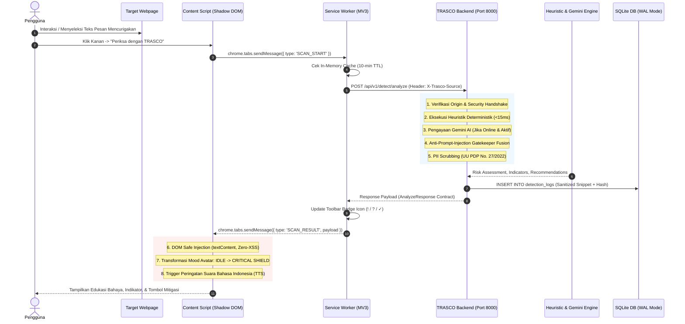
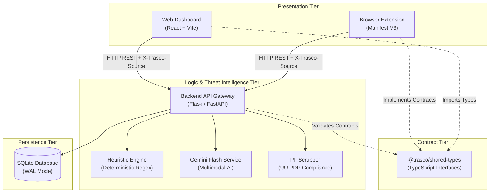

# TRASCO Architecture Specification

> **Document:** System Architecture & Component Design Specification  
> **Repository:** Monorepo (`Trasco---MIT-WEEK-2026`)  
> **Status:** Implemented & Verified  

---

## 1. System Overview & Monorepo Structure

TRASCO is organized as a unified monorepo with strict architectural boundaries between the presentation tier (Browser Extension and Web Dashboard), the business logic tier (Threat Intelligence Engine), and the data contract tier (Shared Types).

```text
Trasco---MIT-WEEK-2026/
├── apps/
│   ├── backend/             # Python Threat Intelligence Engine
│   │   ├── app/
│   │   │   ├── api/v1/      # FastAPI REST Routers (auth, detect, analytics, preferences)
│   │   │   ├── core/        # Core configuration, security hashing, and PII scrubber
│   │   │   ├── models/      # SQLAlchemy ORM models (User, DetectionLog, etc.)
│   │   │   ├── schemas/     # Pydantic data schemas
│   │   │   ├── services/    # Heuristics, Gemini, Scorer, Analytics logic
│   │   │   ├── flask_app.py # Primary lightweight runner (Port 8000)
│   │   │   └── main.py      # Optional FastAPI runner
│   │   ├── tests/           # Backend unit tests
│   │   └── requirements.txt # Python dependency specifications
│   │
│   ├── dashboard/           # Web Dashboard Frontend
│   │   ├── src/
│   │   │   ├── components/  # Atomic React components (Navbar, StatCard, ThreatRadar)
│   │   │   ├── pages/       # Page views (Overview, History, Simulator)
│   │   │   ├── services/    # API client with X-Trasco-Source handshake
│   │   │   ├── App.tsx      # Root SPA router and layout
│   │   │   ├── main.tsx     # React DOM entry point
│   │   │   └── types.ts     # Frontend types re-exported from @trasco/shared-types
│   │   ├── standalone_dashboard.html # Zero-dependency offline SPA (Tailwind + React CDN)
│   │   ├── package.json     # Dashboard npm dependencies
│   │   ├── tsconfig.json    # TypeScript compiler configuration with path alias
│   │   └── vite.config.ts   # Vite bundler configuration
│   │
│   └── extension/           # Browser Extension (Manifest V3)
│       ├── icons/           # 16px, 48px, 128px toolbar shield icons
│       ├── src/
│       │   ├── background/  # Background service worker (event dispatch, cache, badge)
│       │   ├── content/     # Content script (Closed Shadow DOM Avatar, TTS audio)
│       │   └── popup/       # Toolbar popup interface (heartbeat monitor, quick scan)
│       ├── demo_testpage.html # Interactive jury testing playground
│       ├── manifest.json    # Manifest V3 configuration
│       └── package.json     # Extension package metadata
│
├── packages/
│   └── shared-types/        # Canonical TypeScript Contracts (@trasco/shared-types)
│       ├── src/
│       │   ├── detection.ts # Threat levels, categories, AnalyzeRequest/Response
│       │   ├── user.ts      # User and SecurityPreference interfaces
│       │   ├── analytics.ts # Dashboard overview, trends, history interfaces
│       │   └── index.ts     # Barrel export
│       └── package.json     # Shared package definition
│
├── docs/                    # Architecture, security, API, and demo specifications
├── run_all.bat              # 1-Click Ecosystem Launcher (Batch)
├── run_all.ps1              # 1-Click Ecosystem Launcher (PowerShell)
├── run_backend.bat          # Backend-only launcher
├── run_dashboard.bat        # Dashboard-only launcher
├── README.md                # Project README
└── .gitignore               # Secrets, build artifacts, and database exclusions
```

---

## 2. Component Boundaries & Responsibilities

### A. Browser Extension (`apps/extension/`)
- **Service Worker (`src/background/service-worker.js`):**
  - Manages context menu registrations (`selection` and `image`).
  - Implements 10-minute in-memory LRU cache (`domainScanCache`) for hostname scans.
  - Implements a 400ms debounce timer on navigation events (`chrome.tabs.onUpdated`) to prevent request flooding.
  - Controls toolbar badge status (`!`, `?`, `✓`) reflecting real-time tab risk.
  - Attaches `X-Trasco-Source: Extension-Local` to all outgoing API calls.
- **Content Script (`src/content/content-script.js`):**
  - Enforces DOM isolation by creating a **Closed Shadow Root** (`host.attachShadow({ mode: 'open' })`) attached to `#trasco-cyber-guardian-host`.
  - Renders the floating Cyber Guardian Avatar.
  - Strictly uses `document.createElement`, `textContent`, and `createTextNode` for dynamic data rendering (0% `innerHTML` on dynamic content).
  - Triggers Indonesian voice guidance via `window.speechSynthesis` with user-interaction fallbacks.
- **Popup (`src/popup/`):**
  - Provides a real-time heartbeat connection check to `GET /health`.
  - Enables an instant quick-scanner interface for direct URL/text testing.
  - Manages user protection preferences via `chrome.storage.local`.

### B. Threat Intelligence Engine (`apps/backend/`)
- **API Handshake Gatekeeper:**
  - Before-request middleware on `flask_app.py` validating requests originating from legitimate extension or local dashboard origins, requiring `X-Trasco-Source` headers.
- **Deterministic Heuristic Engine (`app/services/heuristic_engine.py`):**
  - Instant regex pattern matching for Indonesian scam dialects (OTP theft, deposit demands, fake job offers, APK malware).
  - URL Shannon entropy analysis and Indonesian financial brand typosquatting checks (BCA, Mandiri, BRI, BNI, Dana, GoPay, OVO, ShopeePay).
- **Gemini Multimodal Enrichment (`app/services/gemini_service.py` & `image_analyzer.py`):**
  - Active deep analysis using Google Gemini Flash when online and API key is present.
  - Offline deterministic fallback when disconnected or unconfigured.
- **Anti-Prompt-Injection Gatekeeper (`app/services/risk_scorer.py`):**
  - Preserves deterministic heuristic danger threshold when heuristic score $\ge 70$.
- **Privacy Scrubber (`app/core/scrubber.py`):**
  - Redacts sensitive PII (NIK, phone, email, OTP, bank account numbers) prior to database logging.
- **Persistence Layer (`app/models/`):**
  - SQLite with WAL mode (`PRAGMA journal_mode=WAL`) ensuring lock-free concurrency.

### C. Web Dashboard (`apps/dashboard/`)
- **Architecture:** Single Page Application (SPA) built with React 18, TypeScript, and Vite.
- **Styling:** Tailwind CSS loaded via CDN and Plus Jakarta Sans typography.
- **Zero-Dependency Fallback:** `standalone_dashboard.html` allows complete offline demonstration without requiring `node_modules` or a local development server.

### D. Shared Contracts (`packages/shared-types/`)
- Single source of truth for interfaces and types across Dashboard, Extension, and Backend API schemas.
- Path-mapped directly in `apps/dashboard/tsconfig.json` (`@trasco/shared-types`).

---

## 3. End-to-End Data Flow



---

## 4. Architectural Boundaries & Dependencies



### Dependency Rules:
1. **Unidirectional Flow:** Frontend applications (`apps/extension`, `apps/dashboard`) depend on Backend API contracts, never the reverse.
2. **Contract Centralization:** Types defined in `packages/shared-types` are canonical. Neither extension nor dashboard should define conflicting custom risk models.
3. **Database Isolation:** Database queries occur strictly inside `apps/backend/app/models/` and route handlers. Neither extension nor frontend has direct database access.

