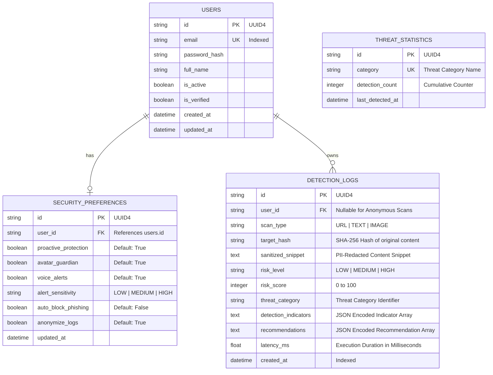

# TRASCO Database & Persistence Specification

> **Engine:** SQLite 3 (SQLAlchemy ORM)  
> **Database File:** `apps/backend/trasco.db`  
> **WAL Files:** `apps/backend/trasco.db-wal`, `apps/backend/trasco.db-shm`  
> **Concurrency Mode:** Write-Ahead Logging (`WAL`)  
> **Status:** Implemented & Verified  

---

## 1. Engine Configuration & Concurrency Architecture

TRASCO utilizes an embedded SQLite database managed via SQLAlchemy ORM. In accordance with the security audit mitigations, SQLite is configured in **WAL (Write-Ahead Logging)** mode to eliminate database locking issues during concurrent reads from the Web Dashboard and writes from the Browser Extension:

```python
# In apps/backend/app/models/base.py
if settings.DATABASE_URL.startswith("sqlite"):
    @event.listens_for(engine, "connect")
    def set_sqlite_pragma(dbapi_connection, connection_record):
        cursor = dbapi_connection.cursor()
        cursor.execute("PRAGMA journal_mode=WAL")
        cursor.execute("PRAGMA synchronous=NORMAL")
        cursor.close()
```

### Key Operational Characteristics:
- **Concurrent Readers & Single Writer:** Readers never block writers, and writers never block readers.
- **Zero-Friction Hackathon Deployment:** Operates as a local file database with zero external service dependencies (no PostgreSQL or MySQL service required to run).

---

## 2. Entity-Relationship Diagram (ERD)



---

## 3. Table Specifications

### A. Table: `detection_logs`
Stores sanitized records of scans performed by users via the Extension or Simulator.

| Column Name | Data Type | Constraints | Description |
|---|---|---|---|
| `id` | `VARCHAR(36)` | PRIMARY KEY | Unique UUID4 scan identifier (`scanId`). |
| `user_id` | `VARCHAR(36)` | FOREIGN KEY (nullable) | References `users.id`. Null during anonymous demo scans. |
| `scan_type` | `VARCHAR(20)` | NOT NULL | Type of scan: `'URL'`, `'TEXT'`, or `'IMAGE'`. |
| `target_hash` | `VARCHAR(64)` | NOT NULL, INDEXED | SHA-256 cryptographic hash of original content. Enables deduplication without storing raw data. |
| `sanitized_snippet` | `TEXT` | NOT NULL | Text snippet with NIK, phone, and OTP redacted via `scrub_pii()`. |
| `risk_level` | `VARCHAR(20)` | NOT NULL | Assessed threat tier: `'LOW'`, `'MEDIUM'`, or `'HIGH'`. |
| `risk_score` | `INTEGER` | NOT NULL | Numerical risk metric between `0` and `100`. |
| `threat_category` | `VARCHAR(50)` | NOT NULL | Category enum: `'SAFE'`, `'PHISHING_URL'`, `'OTP_THEFT'`, etc. |
| `detection_indicators`| `TEXT` | NOT NULL | JSON string serialized array of matched technical indicators. |
| `recommendations` | `TEXT` | NOT NULL | JSON string serialized array of mitigation action steps. |
| `latency_ms` | `FLOAT` | DEFAULT 0.0 | Processing latency in milliseconds. |
| `created_at` | `DATETIME` | NOT NULL, INDEXED | UTC timestamp of detection. |

---

### B. Table: `users`
Stores user credentials for optional multi-device account synchronization.

| Column Name | Data Type | Constraints | Description |
|---|---|---|---|
| `id` | `VARCHAR(36)` | PRIMARY KEY | Unique UUID4 user identifier. |
| `email` | `VARCHAR(255)` | UNIQUE, NOT NULL | Account email address. |
| `password_hash` | `VARCHAR(255)` | NOT NULL | Salted PBKDF2 / SHA-256 password hash. |
| `full_name` | `VARCHAR(100)` | NOT NULL | Display name of the user. |
| `is_active` | `BOOLEAN` | DEFAULT TRUE | Account operational status. |
| `is_verified` | `BOOLEAN` | DEFAULT FALSE | Email verification status. |
| `created_at` | `DATETIME` | NOT NULL | Registration timestamp. |
| `updated_at` | `DATETIME` | NOT NULL | Last account update timestamp. |

---

### C. Table: `security_preferences`
Stores user-specific security settings and avatar customization toggles.

| Column Name | Data Type | Constraints | Description |
|---|---|---|---|
| `id` | `VARCHAR(36)` | PRIMARY KEY | Unique preference identifier. |
| `user_id` | `VARCHAR(36)` | UNIQUE, FOREIGN KEY | Associated user account. |
| `proactive_protection` | `BOOLEAN` | DEFAULT TRUE | Real-time background navigation scanning toggle. |
| `avatar_guardian` | `BOOLEAN` | DEFAULT TRUE | Floating avatar visibility toggle. |
| `voice_alerts` | `BOOLEAN` | DEFAULT TRUE | Web Speech API audio alert synthesis toggle. |
| `alert_sensitivity` | `VARCHAR(20)`| DEFAULT 'MEDIUM' | Sensitivity threshold (`'LOW'`, `'MEDIUM'`, `'HIGH'`). |
| `auto_block_phishing`| `BOOLEAN` | DEFAULT FALSE | Autonomous navigation interruption toggle. |
| `anonymize_logs` | `BOOLEAN` | DEFAULT TRUE | Enforces PII scrubbing prior to log persistence. |
| `updated_at` | `DATETIME` | NOT NULL | Timestamp of last preference update. |

---

### D. Table: `threat_statistics`
Aggregates cumulative threat metrics across detection categories.

| Column Name | Data Type | Constraints | Description |
|---|---|---|---|
| `id` | `VARCHAR(36)` | PRIMARY KEY | Unique record identifier. |
| `category` | `VARCHAR(50)` | UNIQUE, NOT NULL | Threat category key. |
| `detection_count` | `INTEGER` | DEFAULT 0 | Total number of detections recorded. |
| `last_detected_at` | `DATETIME` | NOT NULL | Timestamp of the most recent encounter. |

---

## 4. Privacy & UU PDP Compliance at Database Level

To satisfy Indonesia's **UU No. 27 Tahun 2022 tentang Pelindungan Data Pribadi**:
1. **No Raw Content Logging:** Original user messages or scraped webpage bodies are never saved in raw form. Only SHA-256 hashes (`target_hash`) and redacted snippets (`sanitized_snippet`) are persisted.
2. **Deterministic Deduplication:** The `target_hash` column allows fast cache hits and trend calculations without retaining plaintext user input.
3. **Decoupled User Identity:** The `user_id` column in `detection_logs` is nullable, enabling fully anonymous scan logging during local browser sessions.

