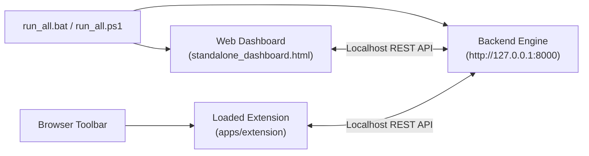

# TRASCO Deployment & Distribution Guide

> **Platform:** TRASCO (Trap & Scope) Monorepo  
> **Target Environments:** Local Hackathon Live Demonstration & Cloud Production  
> **Status:** Active Standard  

---

## 1. Deployment Overview

TRASCO supports two primary deployment topologies:
1. **Zero-Friction Local Hackathon Environment (Default):** All components run locally on the presenter's machine without external database or cloud service dependencies.
2. **Cloud Production Deployment:** Backend containerized behind a reverse proxy, Web Dashboard hosted on edge CDN, and Browser Extension distributed via the Chrome Web Store and Microsoft Edge Add-ons catalog.

---

## 2. Local Hackathon Live Demonstration Setup

For live hackathon evaluations and jury presentations, TRASCO is designed to be fully operational within **10 seconds** via pre-configured scripts:



### Steps to Launch:
1. Double-click [`run_all.bat`](../run_all.bat) or execute [`run_all.ps1`](../run_all.ps1) in PowerShell.
   - Launches `apps/backend/app/flask_app.py` in a separate command window.
   - Automatically opens `apps/dashboard/standalone_dashboard.html` in your default browser.
2. Open `chrome://extensions` or `edge://extensions`:
   - Enable **Developer mode**.
   - Click **Load unpacked** and select the folder `apps/extension`.
3. Open `apps/extension/demo_testpage.html` to begin the 5-minute interactive jury demonstration.

---

## 3. Browser Extension Distribution & Packaging

### A. Development (Unpacked Mode)
- Directly loaded from directory: `apps/extension/`.
- Permitted host origins: `http://localhost:8000/*` and `http://127.0.0.1:8000/*`.

### B. Production Packaging (Chrome Web Store / Edge Add-ons)
To create an archive ready for store submission:
```bash
# Windows PowerShell
Compress-Archive -Path apps/extension/* -DestinationPath dist/trasco-extension-v1.0.0.zip -Force
```
*Verification before upload:*
- Confirm `manifest.json` uses `"manifest_version": 3`.
- Confirm all icons (`icon16.png`, `icon48.png`, `icon128.png`) are included.
- Verify no development-only HTML or tests are bundled into the root of the extension package.

---

## 4. Production Web Dashboard Deployment

### A. Static Build Export
The Web Dashboard compiles into a static single-page application:
```bash
cd apps/dashboard
npm run build
```
Output directory: `apps/dashboard/dist/`
- `dist/index.html` (Application HTML shell)
- `dist/assets/*.js` (Bundled React + Vite application chunks)

### B. Cloud Hosting (Netlify / Vercel / Cloudflare Pages)
- **Build Command:** `npm run build`
- **Output Directory:** `dist`
- **Root Directory:** `apps/dashboard`
- **Environment Variable:** `VITE_API_URL=https://api.trasco.id`

---

## 5. Production Backend Deployment

### A. Production WSGI / ASGI Configuration
For production traffic, replace Flask's development WSGI server with Gunicorn or Uvicorn:

```bash
# Using Gunicorn with Uvicorn workers:
gunicorn -w 4 -k uvicorn.workers.UvicornWorker app.main:app --bind 0.0.0.0:8000
```

### B. Environment Configuration (`.env`)
Ensure the following variables are configured in production:
```ini
PROJECT_NAME="TRASCO Threat Intelligence API"
API_V1_STR="/api/v1"
DEBUG=False
SECRET_KEY="<GENERATE-A-SECURE-64-CHAR-HEX-KEY>"
DATABASE_URL="sqlite:////data/trasco.db"
GEMINI_API_KEY="<AI-STUDIO-PRODUCTION-API-KEY>"
CORS_ORIGINS=["https://dashboard.trasco.id"]
```

### C. Persistent Storage for SQLite WAL
When deploying via Docker or cloud containers:
- Mount a persistent volume at the SQLite directory (e.g., `/data/`).
- Ensure permissions allow the application process to write both the main database file (`trasco.db`) and WAL journal files (`trasco.db-wal`, `trasco.db-shm`).

---

## 6. Pre-Flight Verification Checklist Before Live Pitch

- [ ] Backend is running on `http://127.0.0.1:8000` (`GET /health` returns `200 OK`).
- [ ] Extension is loaded in Chrome/Edge and popup shows green status: **Backend Online (v1.0.0)**.
- [ ] Voice audio test button in popup functions and produces clear Indonesian speech (`id-ID`).
- [ ] Dashboard is open on either `localhost:5173` or `standalone_dashboard.html`.
- [ ] `apps/extension/demo_testpage.html` is open and ready for right-click demo scans.

