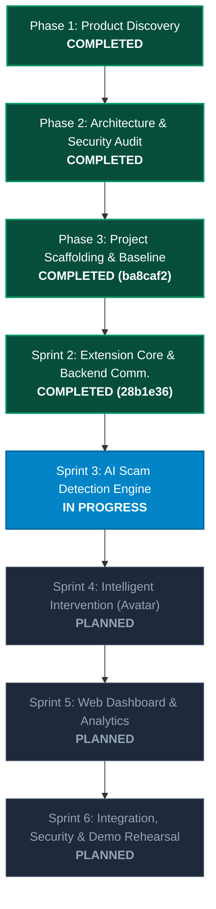

# TRASCO Master Implementation Plan

> **Product:** TRASCO (Trap & Scope) — AI-Powered Cybersecurity Browser Extension & Web Dashboard  
> **Target Audience:** Indonesian youth and active digital citizens vulnerable to online fraud  
> **Track:** Web Development — Cybersecurity Track (MIT UNMUL 2026)  
> **Status:** Version 2.0 (Audited, Hardened & Scaffolding Baseline Established)  

---

## 1. Executive Summary & Product Vision

TRASCO is an integrated digital protection ecosystem designed to proactively detect, intervene against, and educate users about digital threats and cyber scams prevalent in Indonesia—such as fake job offers (*like video TikTok*), advance fee deposit scams, OTP theft, banking typosquatting, APK malware, and fake payment slips.

### Core Value Proposition
> *"An intelligent digital guardian that detects suspicious online activities, warns users before they become victims, and educates them to make safer digital decisions."*

### Three Core Product Pillars
1. **PROACTIVE DETECTION:** Hybrid deterministic heuristics and Google Gemini multimodal AI analyzing URLs, message texts, and transaction slip images.
2. **INTELLIGENT INTERVENTION:** Contextual visual warnings and Indonesian verbal guidance via an **Interactive AI Cyber Guardian Avatar** isolated inside a Closed Shadow DOM.
3. **CONTINUOUS EDUCATION:** Personal threat insights and risk habits quantified through a **Personal Security Hygiene Scorecard** on the Web Dashboard.

---

## 2. Technical Stack & Architectural Decisions

| Layer | Selected Technology | Architecture Decision & Rationale |
|---|---|---|
| **Browser Extension** | Manifest V3 (Chrome & Edge) | Vanilla JavaScript with Closed Shadow DOM. Zero dynamic `innerHTML` to eliminate DOM-based XSS. |
| **Backend API** | Python (Flask primary runner) | Lightweight, zero-friction local execution. SQLite with Write-Ahead Logging (`WAL` mode) for concurrency safety. |
| **Alternative Backend** | FastAPI + Uvicorn | Optional high-throughput asynchronous runner available in `apps/backend/app/main.py`. |
| **AI Threat Engine** | Hybrid Dual-Engine | Deterministic Indonesian heuristic regex (<15ms) + Google Gemini Flash API with Anti-Prompt-Injection Gatekeeper. |
| **Web Dashboard** | React 18 + Vite + TypeScript | Modern SPA with Tailwind CSS. Includes zero-dependency `standalone_dashboard.html` for offline demo presentation. |
| **Shared Contracts** | `@trasco/shared-types` | Canonical TypeScript definitions mapped across Dashboard and Extension for unified contracts. |

---

## 3. Project Roadmap & Implementation Status

### Detailed Phase Status:

#### Phase 1: Product Discovery & Specification (COMPLETED)
- Defined target user persona (Indonesian youth, social media & e-commerce active).
- Formulated threat categories: `PHISHING_URL`, `TYPOSQUATTING`, `FAKE_JOB_OFFER`, `OTP_THEFT`, `DEPOSIT_SCAM`, `FAKE_TRANSFER_SLIP`, `MALICIOUS_DOWNLOAD`, `SOCIAL_ENGINEERING`.
- Approved functional requirements for Extension, Engine, and Dashboard.

#### Phase 2: Independent Architecture & Security Audit (COMPLETED)
- Identified and hardened 5 technical risks: DOM XSS, CORS handshake spoofing, rate limiting, PII leakage, and audio autoplay policy.
- Applied Closed Shadow DOM encapsulation for Avatar.
- Designed PII Scrubber conforming to Indonesia's UU No. 27 Tahun 2022 tentang Pelindungan Data Pribadi.
- Approved Master Plan v2.0 (Hardened).

#### Phase 3: Project Scaffolding & Validation (COMPLETED - Baseline `ba8caf2`)
- Initialized Monorepo layout (`apps/backend`, `apps/dashboard`, `apps/extension`, `packages/shared-types`, `docs`).
- Passed 9/9 Foundation Validation checks.
- Resolved dependency resolution for React 18, Vite, and Shared Types path mappings.
- Clean Git baseline commit `ba8caf2` locked.

#### Sprint 2: Browser Extension Core & Handshake (COMPLETED - Commit `28b1e36`)
- `service-worker.js` with `X-Trasco-Source: Extension-Local` handshake header.
- Extension popup with real-time backend heartbeat monitor (`Online v1.0.0` vs `Offline`).
- Vertical slice quick-scanner communicating from popup to backend API.
- Dynamic toolbar badge icon updates (`!`, `?`, `✓`).

#### Sprint 3: AI Scam Detection Engine (IN PROGRESS)
- Broadening URL typosquatting with homoglyph/lookalike analysis for Indonesian financial institutions (BCA, Mandiri, BRI, BNI, Dana, GoPay, OVO, ShopeePay).
- URL shortener obfuscation detection (`bit.ly`, `tinyurl.com`, `s.id`).
- Expanding Indonesian dialect patterns: fake APK malware, predatory illegal lending (Pinjol), investment fraud, and emergency friend impersonation.

#### Sprint 4: Intelligent Intervention & AI Avatar (PLANNED)
- Avatar state machine refinement (`IDLE_VIGILANT`, `CAUTION_ALERT`, `CRITICAL_SHIELD`).
- Web Speech API speech synthesis fine-tuning (`id-ID`) with user-interaction audio fallbacks.
- Action cards with instant safety actions (*"Tutup Halaman Ini"*, *"Buka Dashboard"*).

#### Sprint 5: Web Dashboard & Analytics (PLANNED)
- Security Hygiene Scorecard (0-100 score).
- Threat distribution visualization and weekly scan trends.
- Interactive Scam Simulator Sandbox with 6 Indonesian scam presets for live jury testing.

#### Sprint 6: Integration, Penetration Testing & Demo Rehearsal (PLANNED)
- End-to-end multi-component integration testing.
- 5-minute hackathon jury walkthrough rehearsal using `docs/demo_scenarios.md`.
- Final production readiness packaging.

