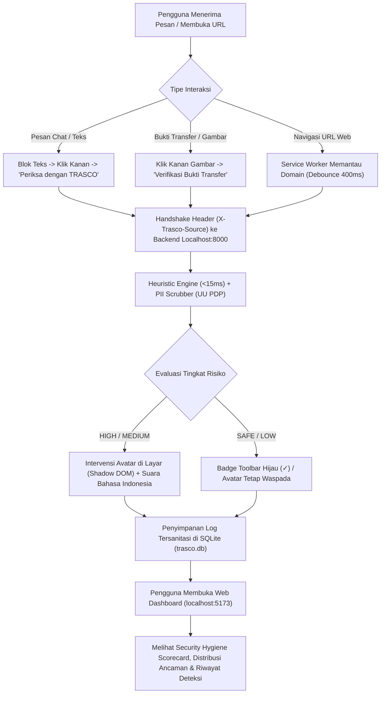

# TRASCO Product Discovery & Architecture Alignment Report

> **Document:** Product Discovery, Ambiguity Resolution & Development Roadmap
> **Status:** Discovery Validated & Finalized
> **Target:** MIT UNMUL 2026 Hackathon (Web Development — Cybersecurity Track)
> **Date:** 2026-11-09

---

## 1. Executive Summary & Project Understanding

TRASCO (Trap & Scope) adalah ekosistem perlindungan siber cerdas yang dirancang untuk melindungi generasi muda Indonesia dari ancaman penipuan digital finansial yang marak terjadi melalui aplikasi pesan instan (WhatsApp, Telegram, SMS), media sosial, dan tautan phishing.

### Tiga Pilar Produk:
1. **Proactive Detection:** Mesin hibrida yang memadukan heuristik regex deterministik bahasa Indonesia berkecepatan tinggi (<15ms) dengan pengayaan multimodal Google Gemini Flash.
2. **Intelligent Intervention:** Karakter Avatar AI Cyber Guardian yang diisolasi di dalam **Closed Shadow DOM** pada Browser Extension Manifest V3, memberikan peringatan visual dan panduan suara bahasa Indonesia (Web Speech API).
3. **Continuous Education:** Dasbor analitik berbasis React + Vite yang mengukur skor kesehatan keamanan digital (*Security Hygiene Scorecard*) dan riwayat pemindaian langsung dari basis data lokal SQLite (WAL mode).

---

## 2. Verified Implementation Status (Audit Aktual Berbasis Bukti)

Berdasarkan audit independen terhadap kode program dan eksekusi pengujian riil:

| Komponen | Status Aktual | Bukti Verifikasi |
|---|:---:|---|
| **Deterministic Heuristic Engine** | **VERIFIED** | 7 pattern scam Indonesia (OTP, tugas like TikTok, deposit fiktif, APK malware, undian, urgensi, rekening). 6/6 tests passed. |
| **PII Data Scrubber (UU PDP)** | **VERIFIED** | Sensor otomatis NIK (16 digit), No HP Indonesia (fleksibel tanda hubung/spasi/kode negara), Email, OTP (6 digit), Rekening Bank (10-14 digit). 5/5 tests passed. |
| **Security Firewall & Gatekeeper (SEC-01)**| **VERIFIED** | CORS allowlist ketat (`localhost:5173`, `127.0.0.1:5173`, ekstensi MV3), loopback binding `127.0.0.1:8000`, eliminasi risiko DNS rebinding & LAN probing. 8/8 tests passed. |
| **Universal Heuristic Risk Floor (SEC-02)**| **VERIFIED** | Nilai deteksi heuristik menjadi batas bawah mutlak; manipulasi prompt injection tidak dapat menurunkan skor ancaman. 6/6 tests passed. |
| **Browser Extension MV3 Core** | **VERIFIED** | Service Worker background dengan debounce navigasi 400ms, LRU cache domain 10 menit, toolbar badge status (`!`, `?`, `✓`). |
| **Avatar Cyber Guardian** | **VERIFIED** | Content script dengan isolasi Closed Shadow DOM `#trasco-cyber-guardian-host`, zero dynamic `innerHTML` (anti-XSS), audio guidance native `id-ID`. |
| **Web Dashboard** | **VERIFIED** | React 18 + Vite SPA, clean TypeScript compilation (`tsc -b && vite build` sukses 39 modules). |
| **Shared Contracts (@trasco/shared-types)**| **VERIFIED** | Modul barrel types `detection.ts`, `user.ts`, `analytics.ts` terpetakan lintas monorepo. |
| **CI/CD Quality Gate** | **VERIFIED** | `.github/workflows/ci.yml` lolos 100% pada remote GitHub Actions (Run ID `42495184515`). |
| **Multimodal Gemini AI** | **PARTIALLY IMPLEMENTED** | Kode integrasi siap (`gemini_service.py`), berjalan dengan graceful fallback jika API key kosong. |
| **User Authentication / Cloud Sync** | **NOT IMPLEMENTED (DEFERRED)**| Berdasarkan hasil discovery, autentikasi multi-user ditunda demi kemudahan demo juri hackathon 5 menit. |

---

## 3. Product Ambiguities & Architectural Decisions (Terselesaikan)

Berdasarkan wawancara penyelarasan produk:

1. **Prioritas Deteksi Sprint 3:**
   - **Keputusan:** Memprioritaskan **deteksi teks percakapan dan pesan media sosial/chat (WhatsApp, Telegram, SMS)**.
   - **Rasional:** Sebagian besar korban penipuan di Indonesia terpapar melalui rekayasa sosial di ruang obrolan (tugas paruh waktu, pinjol ilegal, impersonasi keluarga darurat, dan skema ponzi).
2. **Strategi Integrasi Dual-Engine Gemini AI:**
   - **Keputusan:** **Dual-Engine Graceful Fallback**. Heuristik lokal selalu berjalan instan (<15ms) sebagai garda utama deterministik. Gemini Flash hanya dipanggil untuk kasus teks ambigu atau pemindaian gambar bukti transfer jika API key tersedia.
   - **Rasional:** Menjamin demo juri 100% andal tanpa risiko gagal akibat latensi jaringan atau kuota habis (15 RPM).
3. **Model Identitas & Akses Dasbor:**
   - **Keputusan:** **Local-First Zero-Login Analytics**. Dasbor langsung menyajikan metrik keamanan dan riwayat dari SQLite lokal `trasco.db` melalui `GET /api/v1/analytics/*`.
   - **Rasional:** Eliminasi friksi saat penilaian hackathon; juri dapat langsung melihat data analitik tanpa hambatan form login.

---

## 4. User Journey Map (Hackathon Live Demo Flow)

---

## 5. Prioritized Feature Backlog & Roadmap

### Sprint 3: AI Scam Detection Engine (FOKUS BERIKUTNYA)
- **Objective:** Memperluas cakupan heuristik bahasa Indonesia dengan pola-pola penipuan paling merugikan.
- **Fitur yang Dikembangkan:**
  1. *Pinjaman Online Ilegal (Pinjol):* Deteksi janji pencairan tanpa syarat, ancaman sebar kontak, tanpa izin OJK.
  2. *Investasi Bodong / Ponzi:* Skema titip dana, profit harian pasti, robot trading bodong.
  3. *Emergency Catfishing:* Modus teman/keluarga kecelakaan atau ditangkap polisi meminta tebusan mendesak.
  4. *URL Obfuscation & Typosquatting:* Deteksi penyingkat URL (`bit.ly`, `s.id`, dll.) dan penggantian karakter lookalike/homoglif.
- **Acceptance Criteria:** Seluruh 34 regression tests tetap lulus + minimal 5 unit tests baru dengan skor eksekusi <15ms.

### Sprint 4: Intelligent Intervention (Avatar & Voice Refinement)
- **Objective:** Penyempurnaan responsivitas visual dan audio avatar.
- **Fitur yang Dikembangkan:** State machine avatar (Shield animation, Audio fallbacks, Quick dismiss).

### Sprint 5: Web Dashboard & Interactive Scam Simulator
- **Objective:** Visualisasi analitik dan sarana edukasi interaktif.
- **Fitur yang Dikembangkan:** Integrasi live polling ke `trasco.db`, filter riwayat pemindaian, dan simulator skenario penipuan untuk uji coba juri.

### Sprint 6: Final Integration, Hardening & Live Demo Rehearsal
- **Objective:** Validasi menyeluruh dan latihan presentasi demo 5 menit.
- **Fitur yang Dikembangkan:** Skenario demo interaktif di `apps/extension/demo_testpage.html` dan script presentasi 1-klik (`run_all.bat`).

---

## 6. Project Readiness Evaluation

| Dimensi Evaluasi | Status Kesiapan | Catatan Evaluasi |
|---|:---:|---|
| **Product Clarity** | **READY** | Masalah, sasaran pengguna, dan skenario penggunaan terspesifikasi jelas. |
| **Technical Architecture** | **READY** | Monorepo terisolasi dengan rapi, kontrak tipe terpadu, SQLite WAL stabil. |
| **Feature Completeness (Sprint 2)** | **READY** | Komunikasi ekstensi-backend-dasbor berjalan dengan baik. |
| **Security Readiness** | **READY** | Memenuhi UU PDP, perlindungan anti-XSS, anti-CSRF, anti-prompt-injection. |
| **Testing & CI Readiness** | **READY** | 34/34 unit test passed, GitHub Actions CI terbukti hijau. |
| **Hackathon Readiness** | **READY** | Topologi lokal 100% mandiri tanpa hambatan koneksi internet luar. |

**Keputusan Akhir:**
### **READY FOR SPRINT 3 IMPLEMENTATION** 🚀
